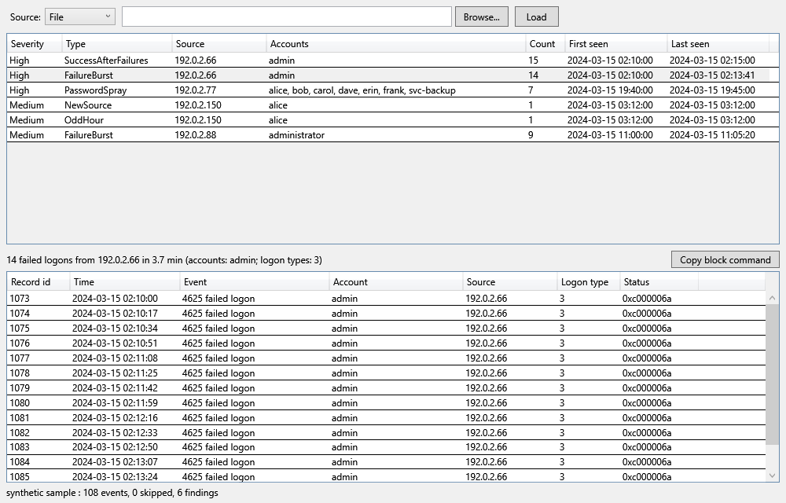

# loginwatch

Looks through Windows logon events (4624, 4625, 4634, 4648, 4672, 4776) for brute force and odd logons, and says which event record ids back each finding. PowerShell 5.1, no dependencies. It only reports unless you ask for more.

The screenshot is the GUI on synthetic events (documentation address ranges only).

## What it flags

- failure burst: 5+ failed logons from one source within 10 minutes
- password spray: 4+ different accounts failing from one source within 10 minutes
- success after failures: a logon from the same source and account after 3+ failures within 15 minutes
- odd hour: an account logging on in an hour (and the hours either side) it has never used
- new source: an account logging on from an address it has not used before

The last two need a baseline of at least 20 earlier logons for that account. Within one run the baseline is learned from the events themselves in time order; to keep one between runs use `-BaselinePath` and `-SaveBaseline`. Logon types counted for the baseline are 2, 3, 7, 10 and 11; machine accounts and ANONYMOUS LOGON are ignored. Thresholds are parameters (`-BurstThreshold`, `-BurstWindowMinutes`, `-SprayAccounts`, `-SuccessAfterFailures`).

## Running

    .\loginwatch.ps1 -Live                          # Security log, last 24 h (-Hours N)
    .\loginwatch.ps1 -Path export.evtx              # exported log
    .\loginwatch.ps1 -Path events.jsonl             # the JSON-lines format below
    .\loginwatch.ps1 -Sample                        # built-in synthetic events
    .\loginwatch.ps1 -Path events.jsonl -Json

Exit code is 1 when there are findings, 0 when there are none, 2 on an error. Reading the Security log needs an elevated prompt (or Event Log Readers membership). Without it you get a one-line "access denied" message and exit 2. `Get-WinEvent` with a filter reports an unreadable log as "no events found", so loginwatch probes the log unfiltered to tell the two apart.

To produce a file without admin on the analysis machine, export on the monitored one: `wevtutil epl Security sec.evtx`, or run `.\loginwatch.ps1 -Live -ExportJsonl events.jsonl` there.

### JSON-lines format

One object per line:

    {"EventId":4625,"RecordId":1073,"Time":"2024-03-15T02:10:00+00:00","Account":"admin","Source":"192.0.2.66","LogonType":3,"Workstation":"","Status":"0xc000006a"}

`EventId`, `RecordId` and `Time` are required. Lines that are not valid or lack those are skipped and listed on stderr. `Status` for 4625 is the SubStatus.

## Blocking

Off by default.

    .\loginwatch.ps1 -Path events.jsonl -BlockSuggestion      # prints netsh commands only
    .\loginwatch.ps1 -Path events.jsonl -Apply -WhatIf        # shows what would be created
    .\loginwatch.ps1 -Path events.jsonl -Apply                # asks first, needs admin
    .\loginwatch.ps1 -Unblock                                 # removes rules named loginwatch-*

Only sources behind bursts, sprays and success-after-failures are candidates. Private, loopback, link-local and CGNAT ranges are never blocked, nor are this machine's own addresses, established RDP/SSH client addresses, or the most recent source seen for the current user. That last check is a heuristic: a source it does not know about can still get blocked, so read the list at the confirmation prompt.

## GUI

    powershell -STA -File .\loginwatch-gui.ps1 -Sample
    powershell -STA -File .\loginwatch-gui.ps1 -Path events.jsonl
    powershell -STA -File .\loginwatch-gui.ps1 -Live

A table of findings (severity, type, source, accounts, count, first and last seen) with the evidence events and their record ids for the selected finding underneath. Pick the live Security log or a file at the top and press Load (F5 reloads). "Copy block command" puts the `netsh` line for the selected source on the clipboard; it does not run it, and it stays disabled for non-attack findings, private addresses and this machine's own addresses.

`-SelfTest` loads synthetic events, checks the table, evidence and copy logic, and exits; add `-Png path` to render the window to a file (this produced the screenshot):

    powershell -STA -File .\loginwatch-gui.ps1 -SelfTest -Png docs\gui.png

## Tests

    powershell -File tests\run-tests.ps1

Uses synthetic fixtures built in code, including malformed JSON lines, malformed event XML and a corrupt .evtx. The live-read test passes whether or not you are elevated.

## Limits

- No continuous watching; it analyses one pass over the log (the GUI reloads on F5).
- The `-Apply` path and the real elevated Security-log read are not covered by tests (CI runs unelevated and should not touch the firewall); only `-WhatIf` and the refusal path are.
- The GUI self test checks the data behind the window and renders a PNG; clicking through the window by hand is not automated.
- Time-of-day is in the local time of the machine that reads the data; a JSON-lines file from another zone keeps its own offsets.
- Hostname-only sources (no IP) are not correlated.
- Source addresses are taken as logged; behind NAT or a gateway they are the gateway's.
